# Add a new competitor and their first entry

Create a competitor from the Competitors page, then enter them in a class from their profile. This guide is for show office staff and secretaries taking entries at the office or over the phone.

## Before you start

- Sign in as **office staff**.
- Make sure **Riverbend Show 2026** is the current show.

## Steps

### Part 1: Add the competitor

#### 1. Check the current show

Sign in and start on the **Dashboard**. Check the **Current show** at the bottom of the left-hand menu is the show you're taking entries for.

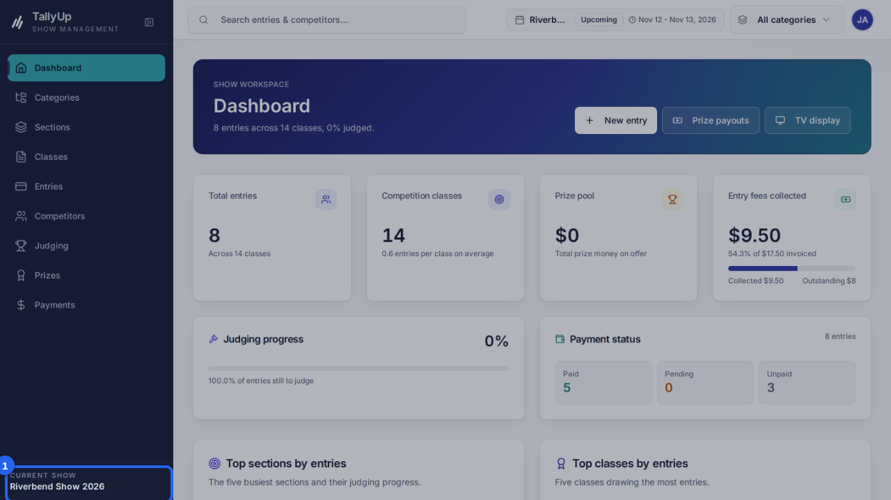

#### 2. Open Competitors

Click **Competitors** in the left-hand menu.

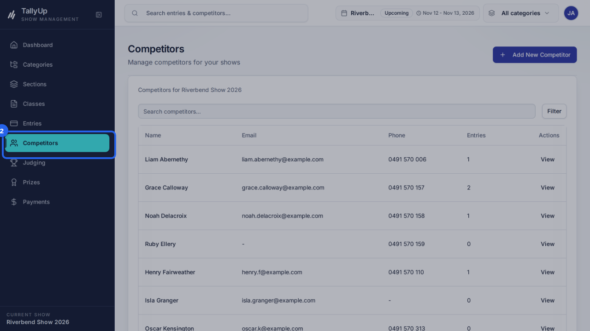

#### 3. Search before you add

Competitors are shared across all your shows. Type the person's name into **Search competitors...** first, so you don't create a duplicate. If they're already listed, skip ahead to [their profile](#8-open-their-profile).

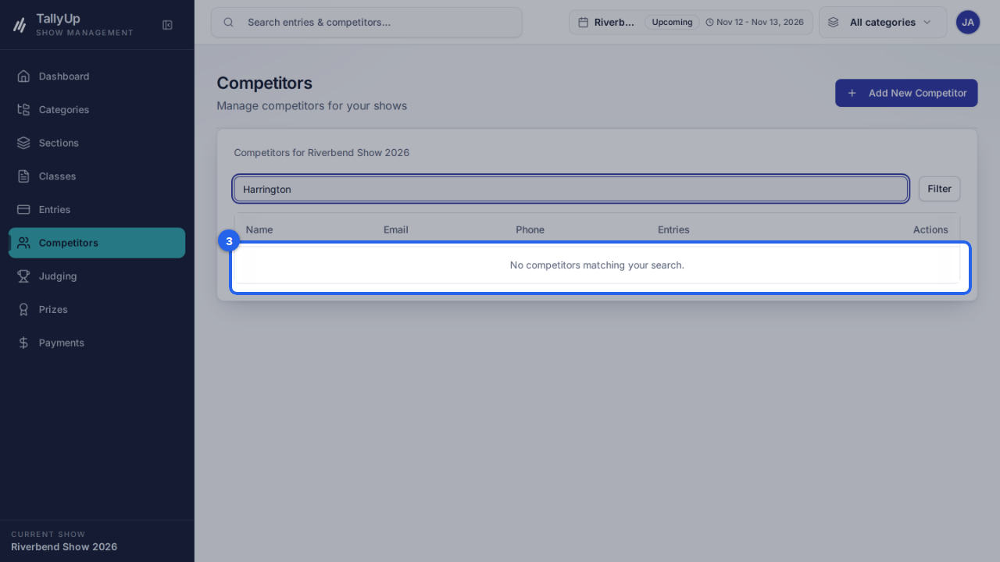

#### 4. Add New Competitor

No match? Click **Add New Competitor** at the top right.

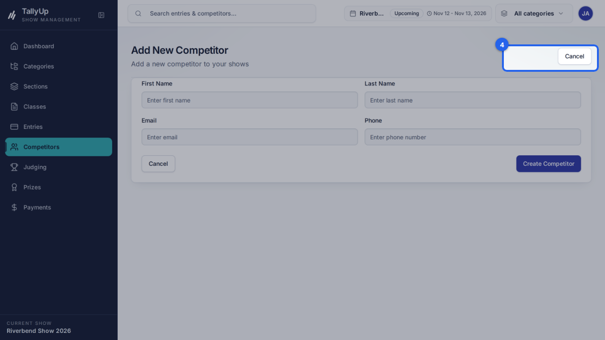

#### 5. Enter their name

Enter the competitor's **First Name** and **Last Name** (both required, at least two characters).

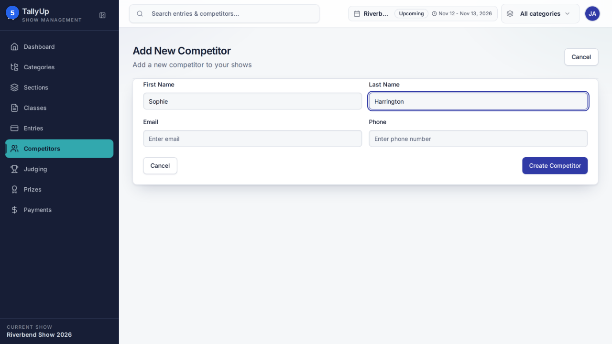

#### 6. Add contact details

**Email** and **Phone** are optional. With an email address, TallyUp sends the competitor an entry confirmation and you can email them a payment link later.

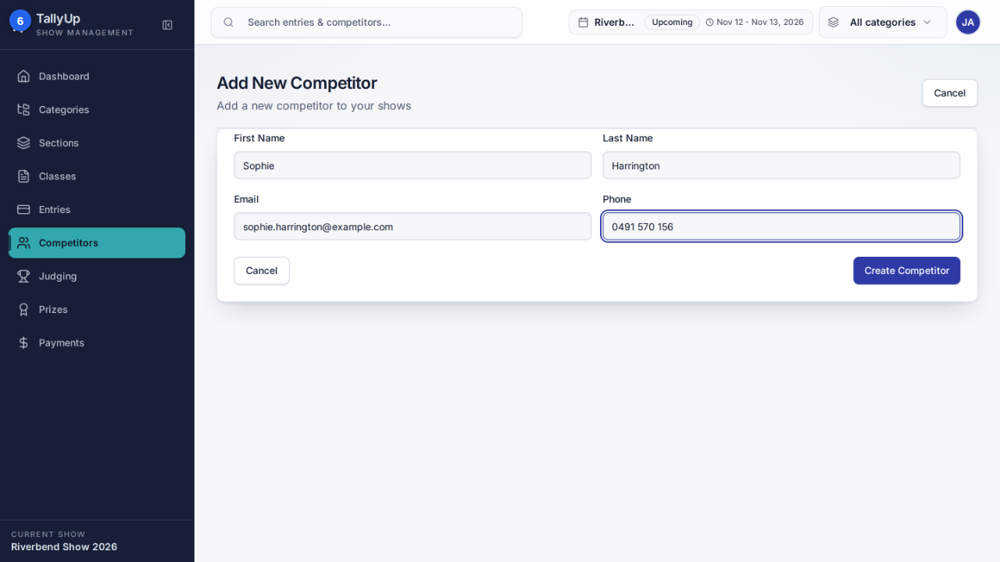

#### 7. Create Competitor

Click **Create Competitor**. A *Competitor created* message appears and you're returned to the competitor list.

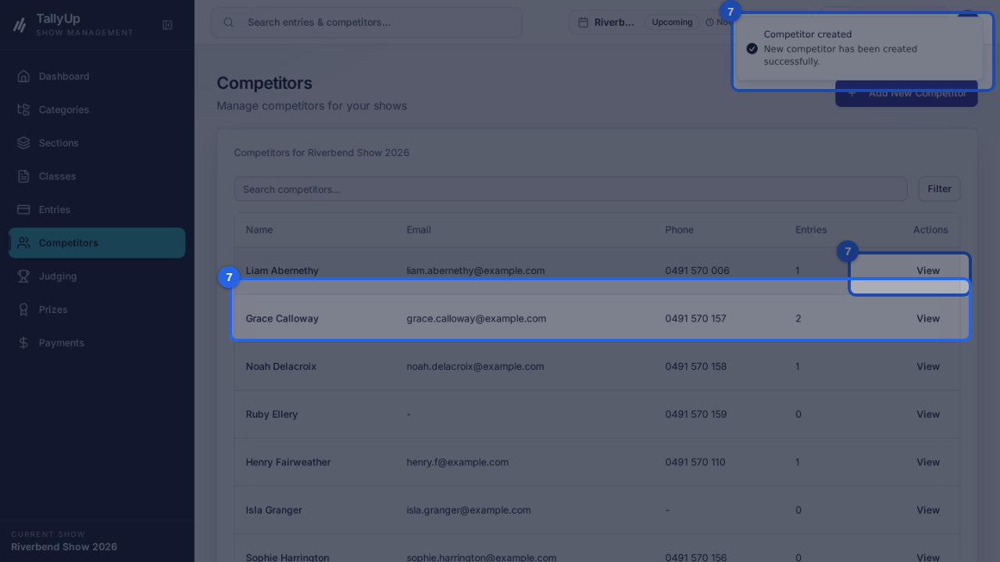

### Part 2: Add the entry

#### 8. Open their profile

Search for the competitor again and click **View** on their row to open their profile.

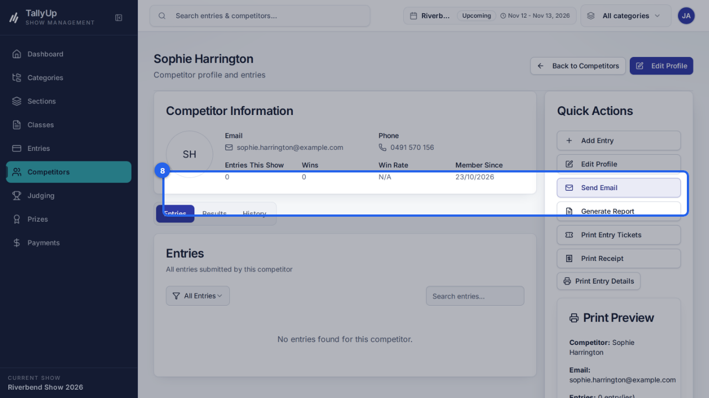

#### 9. Add Entry

The profile shows their details and entries for this show (none yet). Under **Quick Actions**, click **Add Entry**.

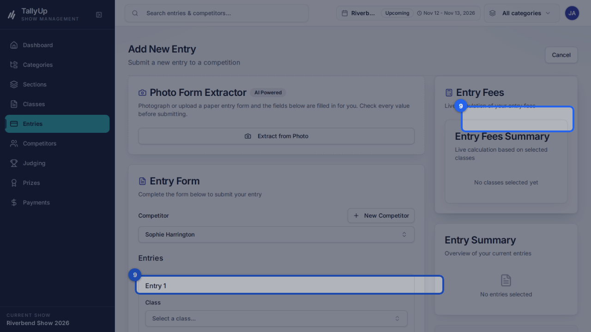

#### 10. Competitor already selected

The **Add New Entry** form opens with the competitor already selected.

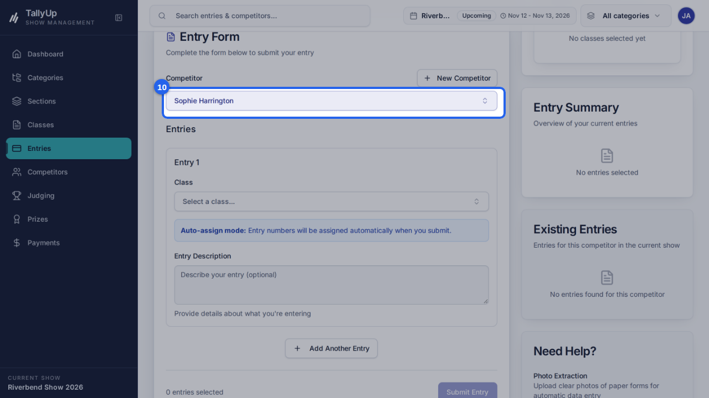

#### 11. Choose a class

Click **Select a class...** and search by class name, code or section — for example `banana` — then click the class (shown as code and name, e.g. *CK03 - Banana bread*).

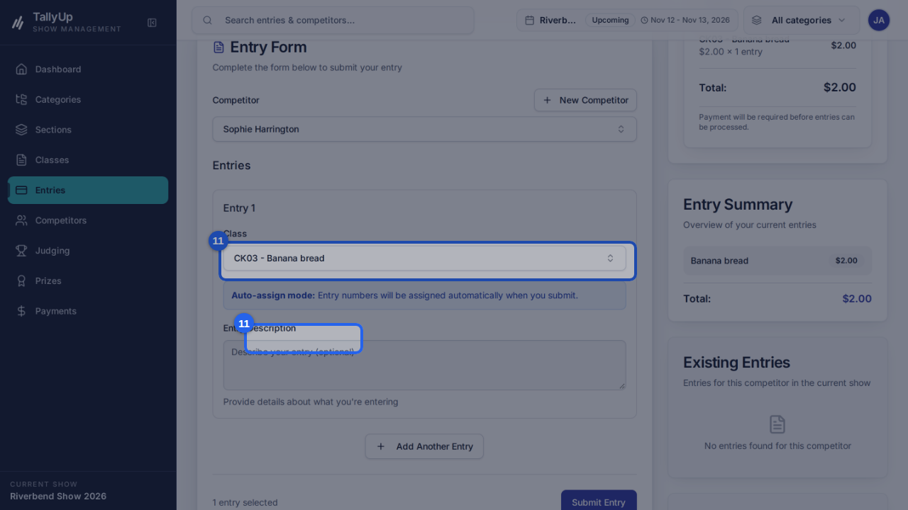

#### 12. Entry number and fee

For automatically numbered classes the form notes *Entry numbers will be assigned automatically when you submit.* The **Entry Summary** on the right adds up the fees. (Classes with hand-entered numbers, such as poultry cage numbers, show an **Entry Number (Optional)** box instead.)

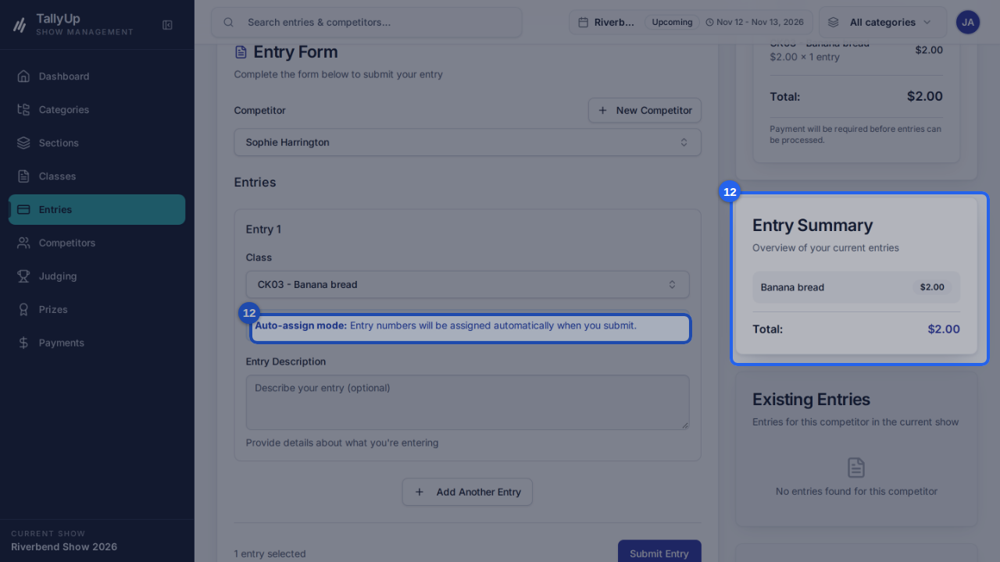

#### 13. Optional description

Optionally add an **Entry Description**. To enter the same competitor in more classes, click **Add Another Entry** and repeat for each class.

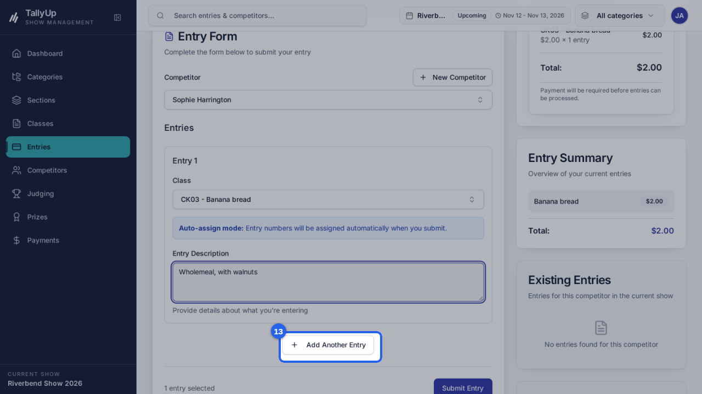

#### 14. Submit Entry

Check the details and click **Submit Entry**.

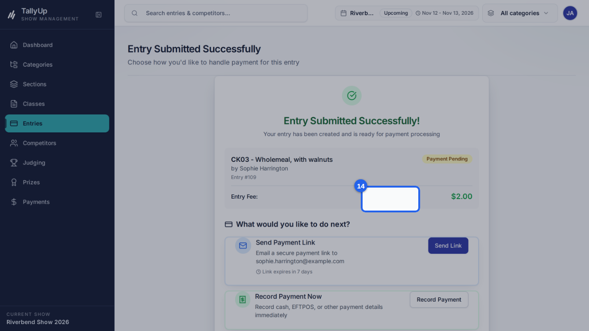

#### 15. Entry submitted

The entry is saved with its entry number and shows **Payment Pending**. Choose **Send Link** to email a secure payment link, or **Record Payment** for cash or EFTPOS. **Create Another Entry** starts a fresh form.

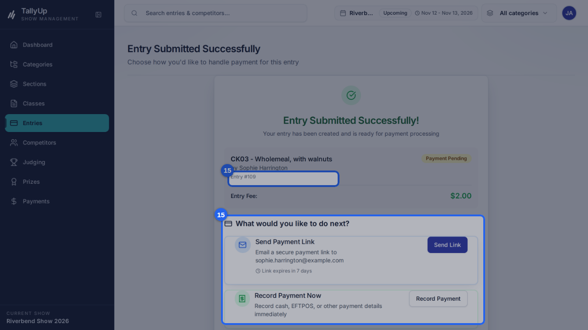

## Good to know

- Search Competitors first
- Add New Competitor
- Open their profile, then Add Entry
- Choose a class and Submit Entry

---

*Steps verified against the real app on 2026-10-22.*
