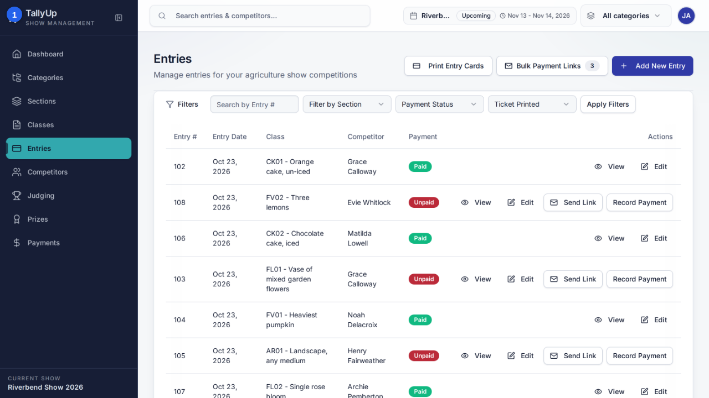

# Find unpaid entries

Filter the entries list to show only entries that haven't been paid. This guide is for show office staff following up entry fees.

## Before you start

- Sign in as **office staff**.
- Make sure **Riverbend Show 2026** is the current show.

## Steps

### Part 1: Filter entries

#### 1. Open Entries

Click **Entries** in the left-hand menu.

#### 2. Choose Unpaid

Open **Payment Status** and choose **\{\{filter.status\}\}**.

#### 3. Apply Filters

Click **Apply Filters**. The list shows only unpaid entries.

## Good to know

- Open Entries
- Choose Unpaid under Payment Status
- Apply Filters

---

*Steps verified against the real app on 2026-10-23.*