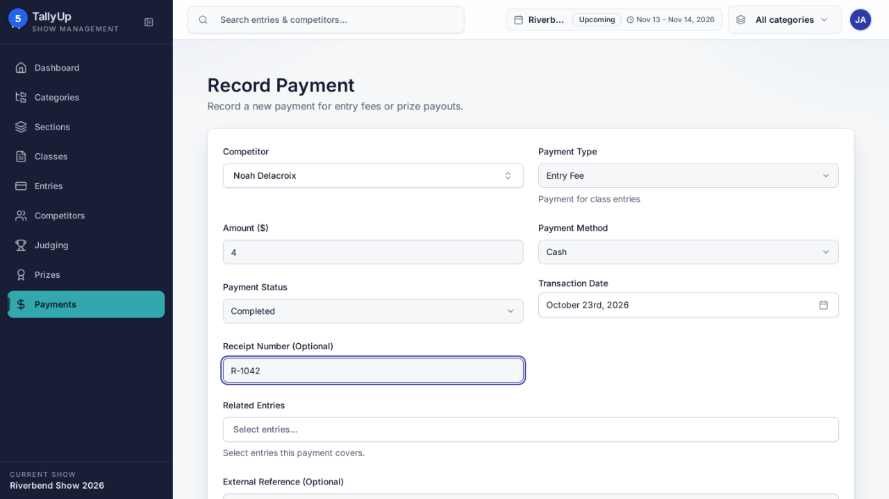

# Record a payment

Record an entry fee a competitor paid at the office. This guide is for show office staff taking entry fees at the office.

## Before you start

- Sign in as **office staff**.
- Make sure **Riverbend Show 2026** is the current show.

## Steps

### Part 1: Record the payment

#### 1. Open Payments

Click **Payments** in the left-hand menu.

#### 2. New Payment

Click **New Payment**.

#### 3. Choose the competitor

Click **Select competitor...** and choose the person who paid.

#### 4. Enter the amount

Enter the **Amount ($)**. **Payment Type** is already **Entry Fee** and **Payment Method** is **Cash**.

#### 5. Enter the receipt number

Enter the **Receipt Number**, if you gave one.

#### 6. Save Payment

Click **Save Payment**. The payment shows in the **Payments** list.

## Good to know

- Open Payments
- New Payment
- Choose the competitor
- Enter the amount and receipt number
- Save Payment

---

*Steps verified against the real app on 2026-10-23.*