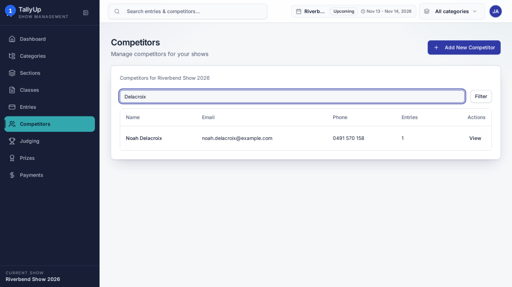
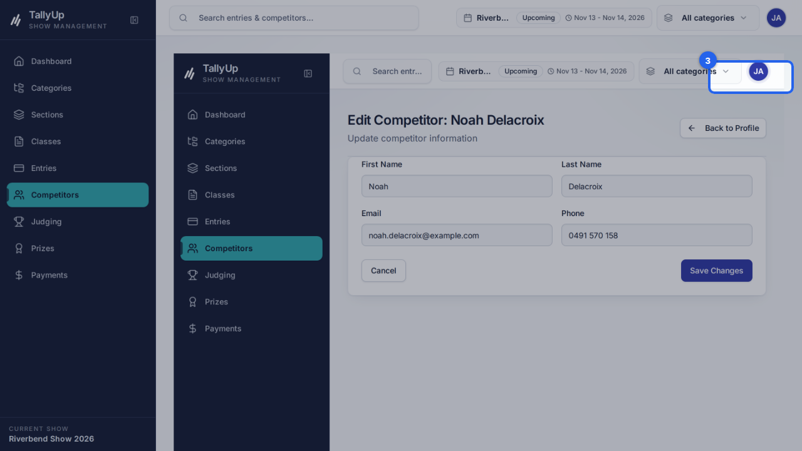
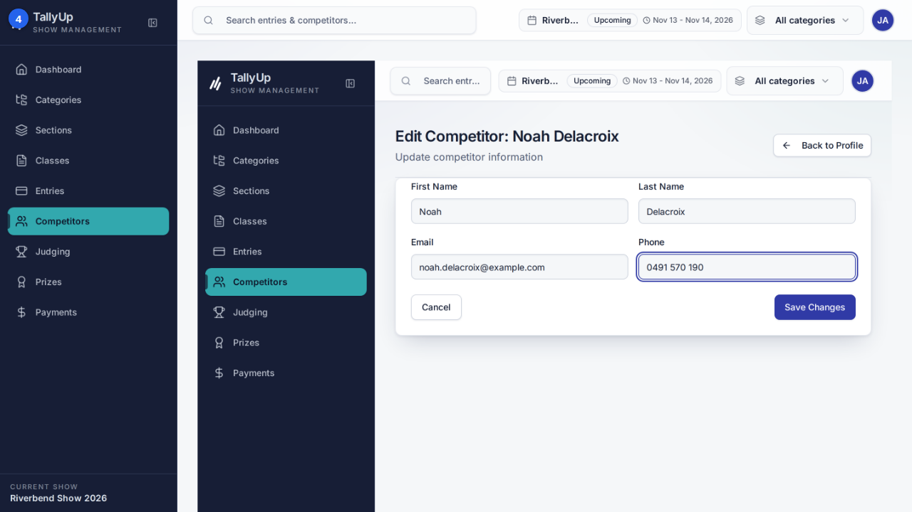

# Update a competitor's phone number

Find a competitor, open their profile, and change their phone number. This guide is for show office staff keeping competitor details current.

## Before you start

- Sign in as **office staff**.
- Make sure **Riverbend Show 2026** is the current show.

## Steps

### Part 1: Find the competitor

#### 1. Search for the competitor

On **Competitors**, type the person's name in **Search**.

#### 2. Open their profile

Click **View** on the competitor's row.

### Part 2: Change the phone number

#### 3. Edit Profile

Click **Edit Profile**.

#### 4. Change the phone number

Replace the number in **Phone**.

#### 5. Save Changes

Click **Save Changes**. The profile shows the new number.

## Good to know

- Search Competitors
- Open their profile
- Edit Profile
- Change the phone number and save

---

*Steps verified against the real app on 2026-10-23.*