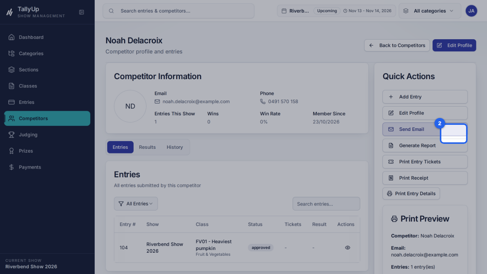
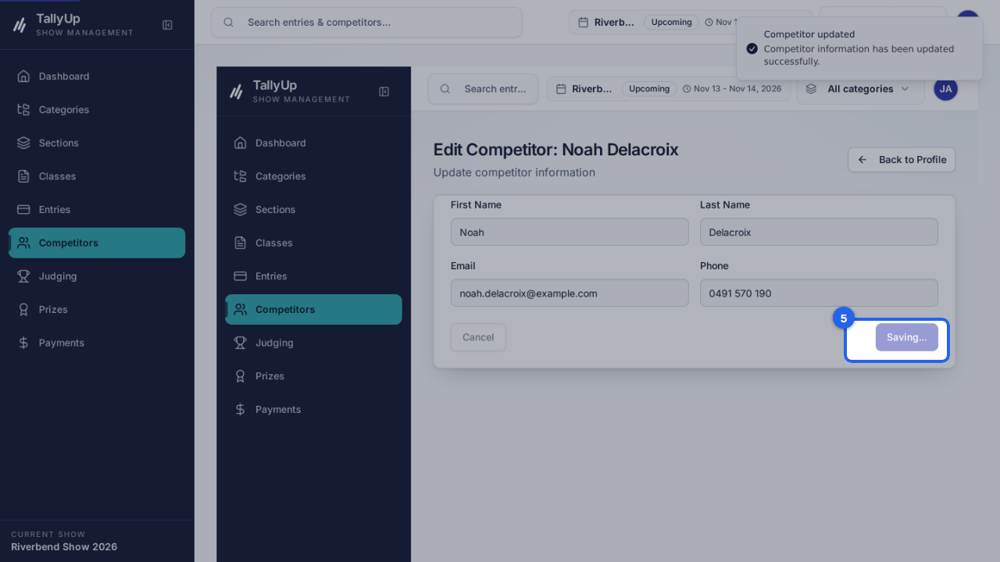

{/* Generated by docgen — edit in the Studio or pages/update-a-competitors-phone/index.mdx */}

{/* docgen:begin header */}
# Update a competitor's phone number

Find a competitor, open their profile, and change their phone number. This guide is for show office staff keeping competitor details current.
{/* docgen:end header */}

{/* docgen:begin before-you-start */}
## Before you start

- Sign in as **office staff**.
- Make sure **Riverbend Show 2026** is the current show.
{/* docgen:end before-you-start */}

{/* docgen:begin steps-heading */}
## Steps
{/* docgen:end steps-heading */}

{/* docgen:begin chapter-1 */}
### Part 1: Find the competitor
{/* docgen:end chapter-1 */}

{/* docgen:begin step-search-competitor */}
#### 1. Search for the competitor

On **Competitors**, type the person's name in **Search**.

{/* docgen:end step-search-competitor */}

{/* docgen:begin step-open-profile */}
#### 2. Open their profile

Click **View** on the competitor's row.

{/* docgen:end step-open-profile */}

{/* docgen:begin chapter-2 */}
### Part 2: Change the phone number
{/* docgen:end chapter-2 */}

{/* docgen:begin step-edit-profile */}
#### 3. Edit Profile

Click **Edit Profile**.

{/* docgen:end step-edit-profile */}

{/* docgen:begin step-change-phone */}
#### 4. Change the phone number

Replace the number in **Phone**.

{/* docgen:end step-change-phone */}

{/* docgen:begin step-save-changes */}
#### 5. Save Changes

Click **Save Changes**. The profile shows the new number.

{/* docgen:end step-save-changes */}

{/* docgen:begin good-to-know */}
## Good to know

- Search Competitors
- Open their profile
- Edit Profile
- Change the phone number and save
{/* docgen:end good-to-know */}

{/* docgen:begin last-checked */}
---

*Steps verified against the real app on 2026-10-23.*
{/* docgen:end last-checked */}
