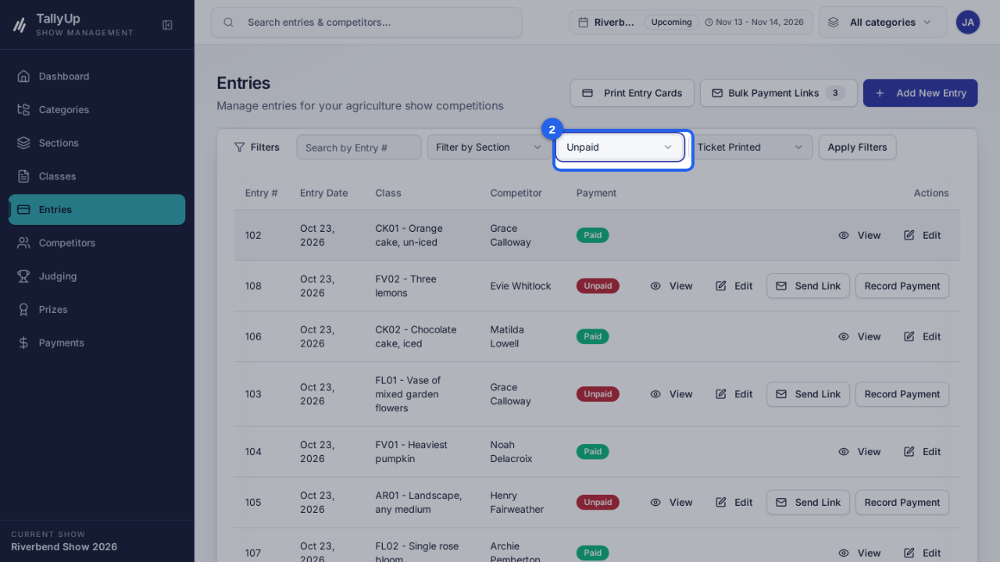
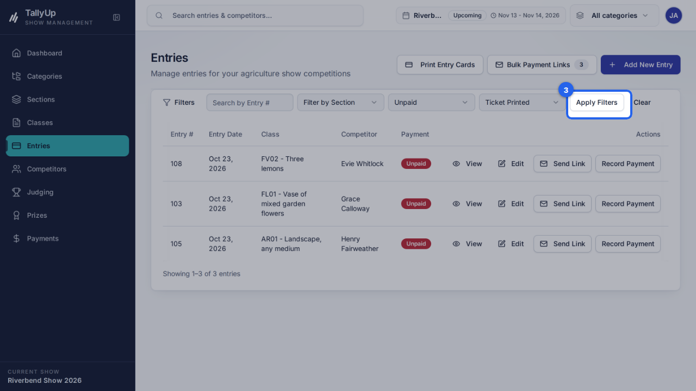

{/* Generated by docgen — edit in the Studio or pages/filter-unpaid-entries/index.mdx */}

{/* docgen:begin header */}
# Find unpaid entries

Filter the entries list to show only entries that haven't been paid. This guide is for show office staff following up entry fees.
{/* docgen:end header */}

{/* docgen:begin before-you-start */}
## Before you start

- Sign in as **office staff**.
- Make sure **Riverbend Show 2026** is the current show.
{/* docgen:end before-you-start */}

{/* docgen:begin steps-heading */}
## Steps
{/* docgen:end steps-heading */}

{/* docgen:begin chapter-1 */}
### Part 1: Filter entries
{/* docgen:end chapter-1 */}

{/* docgen:begin step-open-entries */}
#### 1. Open Entries

Click **Entries** in the left-hand menu.

{/* docgen:end step-open-entries */}

{/* docgen:begin step-choose-unpaid */}
#### 2. Choose Unpaid

Open **Payment Status** and choose **\{\{filter.status\}\}**.

{/* docgen:end step-choose-unpaid */}

{/* docgen:begin step-apply-filters */}
#### 3. Apply Filters

Click **Apply Filters**. The list shows only unpaid entries.

{/* docgen:end step-apply-filters */}

{/* docgen:begin good-to-know */}
## Good to know

- Open Entries
- Choose Unpaid under Payment Status
- Apply Filters
{/* docgen:end good-to-know */}

{/* docgen:begin last-checked */}
---

*Steps verified against the real app on 2026-10-23.*
{/* docgen:end last-checked */}
