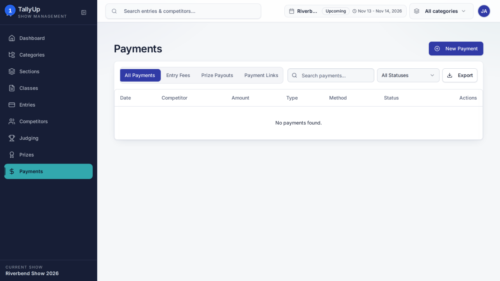
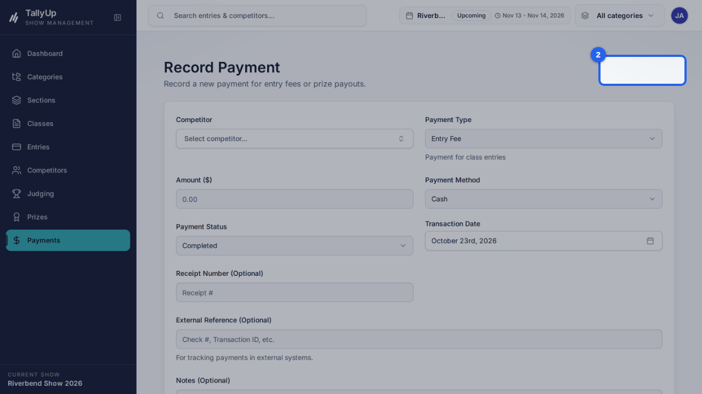
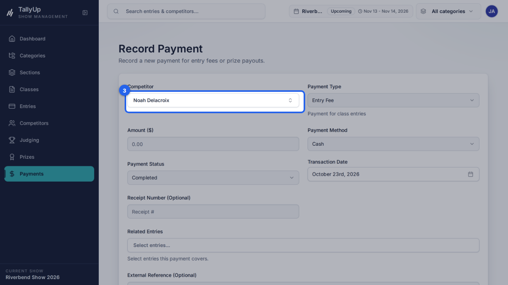
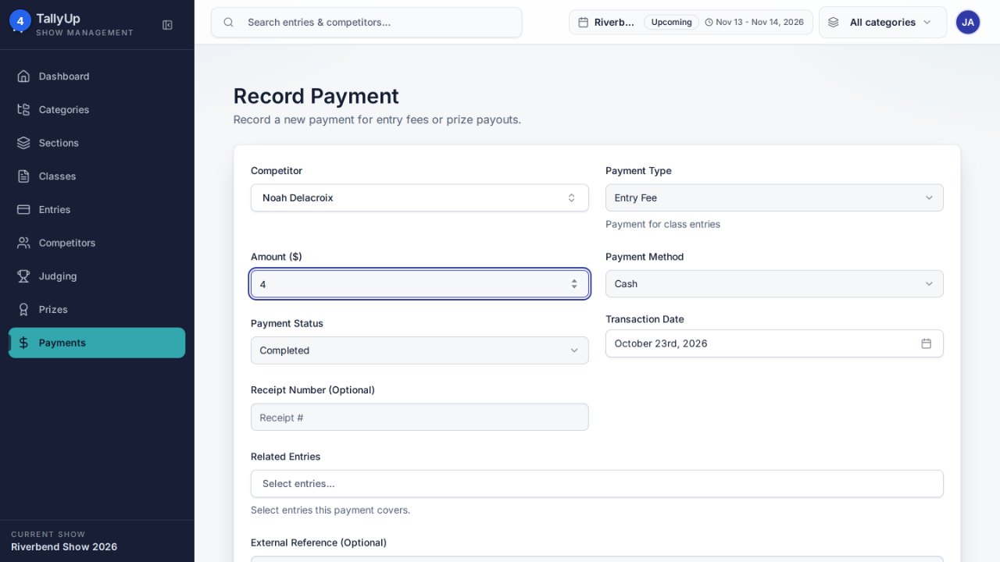
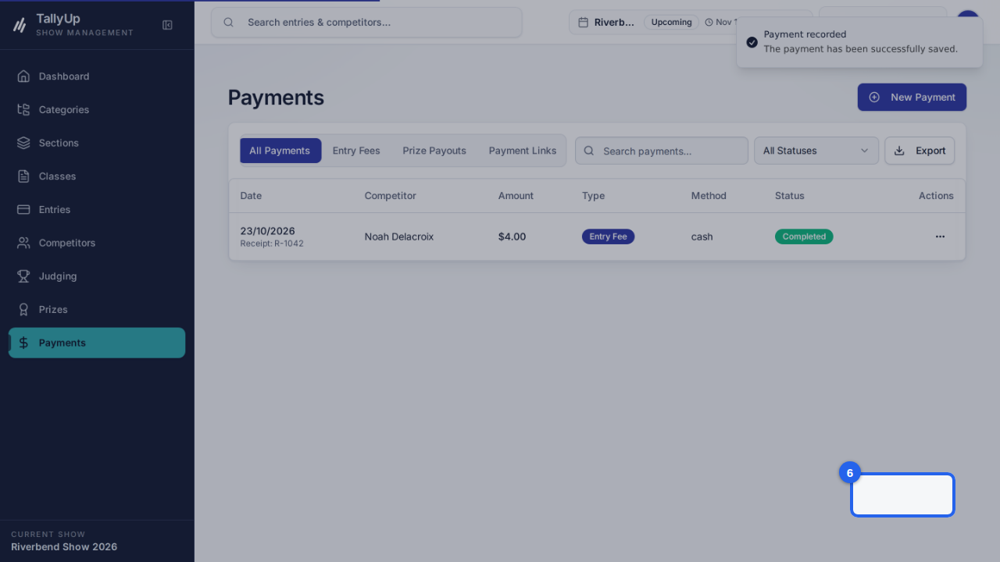

{/* Generated by docgen — edit in the Studio or pages/record-a-payment/index.mdx */}

{/* docgen:begin header */}
# Record a payment

Record an entry fee a competitor paid at the office. This guide is for show office staff taking entry fees at the office.
{/* docgen:end header */}

{/* docgen:begin before-you-start */}
## Before you start

- Sign in as **office staff**.
- Make sure **Riverbend Show 2026** is the current show.
{/* docgen:end before-you-start */}

{/* docgen:begin steps-heading */}
## Steps
{/* docgen:end steps-heading */}

{/* docgen:begin chapter-1 */}
### Part 1: Record the payment
{/* docgen:end chapter-1 */}

{/* docgen:begin step-open-payments */}
#### 1. Open Payments

Click **Payments** in the left-hand menu.

{/* docgen:end step-open-payments */}

{/* docgen:begin step-new-payment */}
#### 2. New Payment

Click **New Payment**.

{/* docgen:end step-new-payment */}

{/* docgen:begin step-choose-competitor */}
#### 3. Choose the competitor

Click **Select competitor...** and choose the person who paid.

{/* docgen:end step-choose-competitor */}

{/* docgen:begin step-enter-amount */}
#### 4. Enter the amount

Enter the **Amount ($)**. **Payment Type** is already **Entry Fee** and **Payment Method** is **Cash**.

{/* docgen:end step-enter-amount */}

{/* docgen:begin step-enter-receipt */}
#### 5. Enter the receipt number

Enter the **Receipt Number**, if you gave one.

{/* docgen:end step-enter-receipt */}

{/* docgen:begin step-save-payment */}
#### 6. Save Payment

Click **Save Payment**. The payment shows in the **Payments** list.

{/* docgen:end step-save-payment */}

{/* docgen:begin good-to-know */}
## Good to know

- Open Payments
- New Payment
- Choose the competitor
- Enter the amount and receipt number
- Save Payment
{/* docgen:end good-to-know */}

{/* docgen:begin last-checked */}
---

*Steps verified against the real app on 2026-10-23.*
{/* docgen:end last-checked */}
